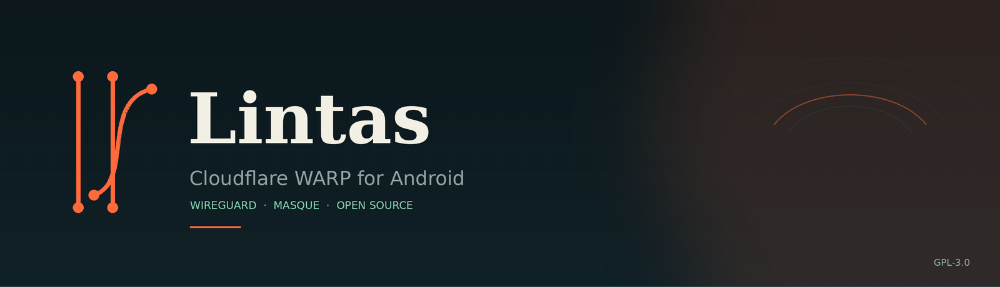
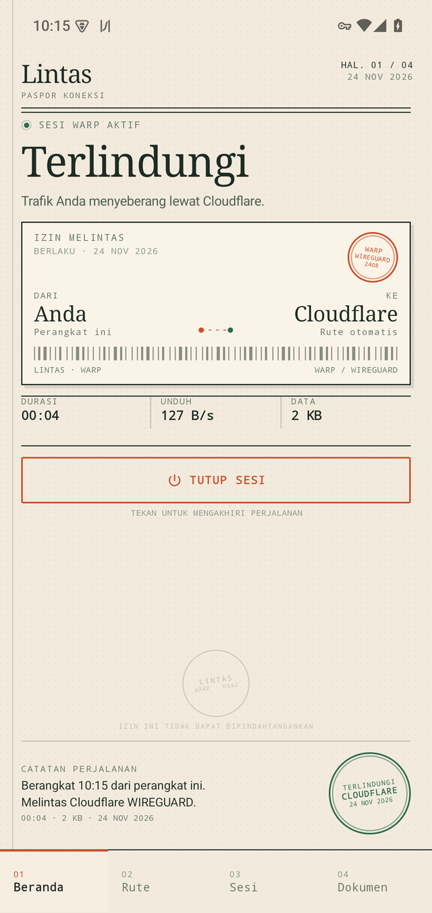
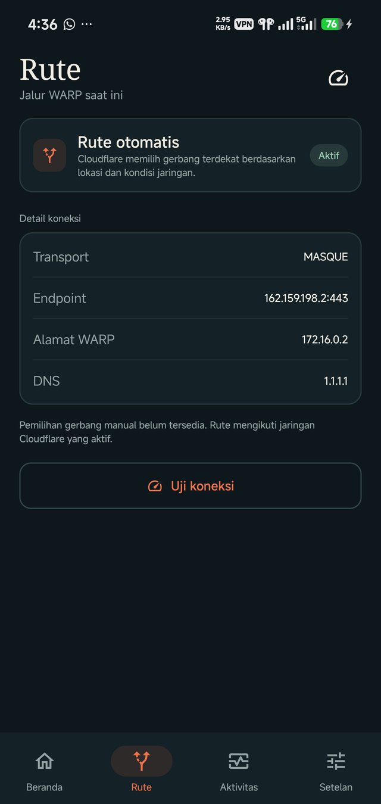
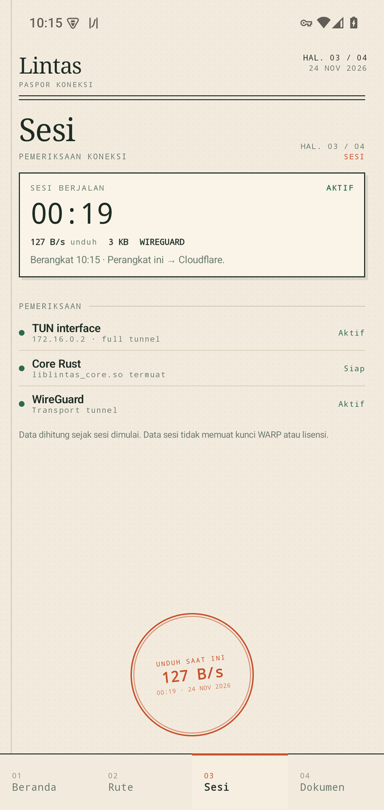
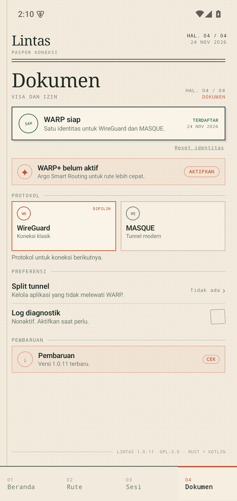
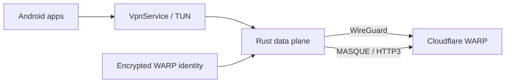

<p align="center">
  
</p>

<h3 align="center">WARP, without the noise.</h3>

<p align="center">
  WireGuard and MASQUE from one WARP identity.<br>
  No account. No telemetry. No backend in the data path.
</p>

<p align="center">
  <a href="https://github.com/hafizhlf/lintas-vpn/releases/latest"></a>
  
  
  
  <a href="LICENSE"></a>
</p>

## Screenshots

| Beranda | Rute | Sesi | Dokumen |
|:---:|:---:|:---:|:---:|
|  |  |  |  |

## Why Lintas

Lintas is an open-source Android client for Cloudflare WARP. It pairs a Rust
data plane with a Jetpack Compose interface: WireGuard and MASQUE
(HTTP/3 / CONNECT-IP) share one WARP identity, and the app talks directly to
Cloudflare without a relay or account server.

> Lintas is an independent project and is not affiliated with Cloudflare.

## Features

### Two transports, one identity

- **WireGuard** WARP transport with the WARP `client_id` reservation.
- **MASQUE** over QUIC / HTTP/3 with CONNECT-IP.
- WireGuard handshake retry across UDP 2408, 500, 1701, and 4500 plus a
  fallback WARP host; **Coba MASQUE** when WireGuard is blocked.
- Network handover recovery with bounded endpoint DNS, a visible
  **Menyambung ulang** state, and MASQUE handshake retries.
- One WARP consumer identity is shared by both transports. Choose the transport
  in Dokumen; the next connection uses it.

### Built to stay connected

- Restarts the transport when the active Wi-Fi or cellular path changes.
- Keeps the TUN interface up during a handover, so existing TCP sessions are
  not torn down.
- MASQUE keepalive and idle-timeout recovery.
- Detects a stopped native transport thread and reconnects.

### Control and privacy

- **Per-app split tunneling**: selected launcher apps bypass the tunnel.
  Changes apply on the next disconnect and reconnect.
- **WARP+** license activation, account status refresh, and expiry display when
  available.
- **Update checks** from GitHub Releases. Lintas opens the release page in
  your browser; download and install updates manually.
- **Encrypted identity** storage using Android Keystore.
- **Optional local diagnostic log** for transport and reconnect issues.
- No account, billing, telemetry, or backend in the data path.

## How it works



The Kotlin app process talks to a Rust data plane over JNI. The data plane owns
the WireGuard and MASQUE transports; Android `VpnService` owns the TUN
interface. WARP registration and WARP+ activation go directly to Cloudflare.

## Install

1. Download the latest `lintas-<version>.apk` from
   [Releases](https://github.com/hafizhlf/lintas-vpn/releases/latest).
2. Android 10 (API 29) or newer is required.
3. Allow your browser to install unknown apps the first time.
4. Open Lintas, register a free WARP identity in **Dokumen**, then connect.

A WARP+ license key is optional.

Verify the download with the `SHA256SUMS` asset from the same release:

```bash
sha256sum lintas-1.0.13.apk
```

### Update checks

Lintas checks GitHub Releases at most once every 24 hours and on demand from
**Dokumen → Pembaruan**. When a newer release is available, the dialog shows the
version and a button to open the release page in your browser. Download the APK
from there and install it manually; Lintas no longer downloads or installs APKs
on its own.

Installing an update disconnects the VPN; reconnect afterwards.

Lintas reports its VPN network as unmetered, so Android apps do not treat the
tunnel as limited data even when the underlying Wi-Fi is unmetered.

## Build

### Requirements

- JDK 21
- Android SDK 36 (build tools 36.0.0)
- Android NDK 27.0.12077973
- Rust stable with `cargo-ndk`
- `ANDROID_NDK_HOME` pointing at the NDK

### Rust core

```bash
export ANDROID_NDK_HOME=/path/to/android-ndk-r27
cd core
cargo ndk -t arm64-v8a -t x86_64 -P 29 \
  -o ../app/src/main/jniLibs build --release
```

### APK

Build the debug APK:

```bash
./gradlew :app:assembleDebug
```

The debug APK is written to `app/build/outputs/apk/debug/app-debug.apk`.

For a release build, `./gradlew :app:assembleRelease` produces an unsigned
APK; sign it with your own release keystore before distributing it.

## Project layout

```text
app/        Kotlin, Jetpack Compose, VpnService, WARP control plane
core/       Rust data plane, JNI, WireGuard and MASQUE transports
docs/       System design, release plans, and README screenshots
mockups/    UI design reference
```

## Status

Tested on a Poco X8 Pro Max (Android 16) with both WireGuard and MASQUE. The
transport reconnects after active-path changes without tearing down the VPN
interface. Split tunneling is available in Dokumen; update checks open the
GitHub release page. Kill switch is not part of this release yet. The app UI is
in Indonesian.

Releases are published on GitHub. Download and install updates from the release
page with your browser. Installing an update disconnects the VPN; it does not
reconnect automatically.

## Privacy

WARP registration and WARP+ activation talk directly to Cloudflare. Runtime
traffic goes through the WARP tunnel or directly to Cloudflare for
registration and activation; the only non-Cloudflare call is the update check
from GitHub. Lintas does not run a relay or backend.
WARP identity and license
data are stored encrypted on the device. The WARP+ license key is never stored
in plaintext. There is no analytics, telemetry, or crash reporting. The
optional diagnostic log is written locally and can be disabled.

## Acknowledgements

- [Cloudflare WARP](https://1.1.1.1/) for the service.
- [boringtun](https://github.com/cloudflare/boringtun) for the WireGuard
  implementation.
- [quiche](https://github.com/cloudflare/quiche) for QUIC / HTTP/3.
- [Jetpack Compose](https://developer.android.com/compose) and
  [OkHttp](https://square.github.io/okhttp/).

## License

GPL-3.0. See [LICENSE](LICENSE).

Lintas is an independent project and is not affiliated with Cloudflare.
