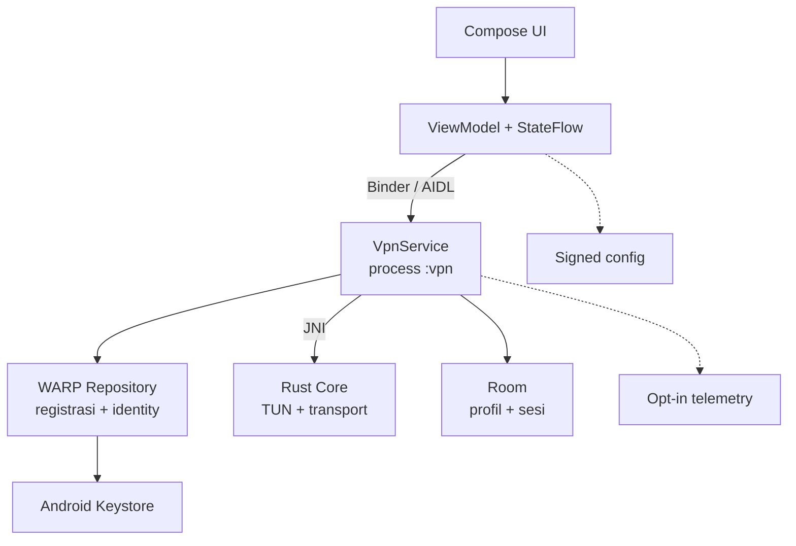
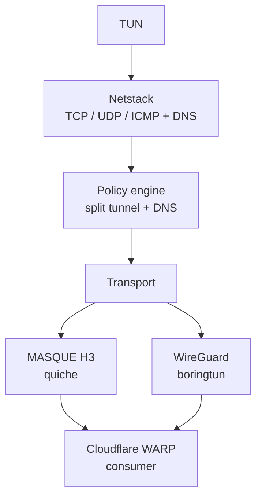
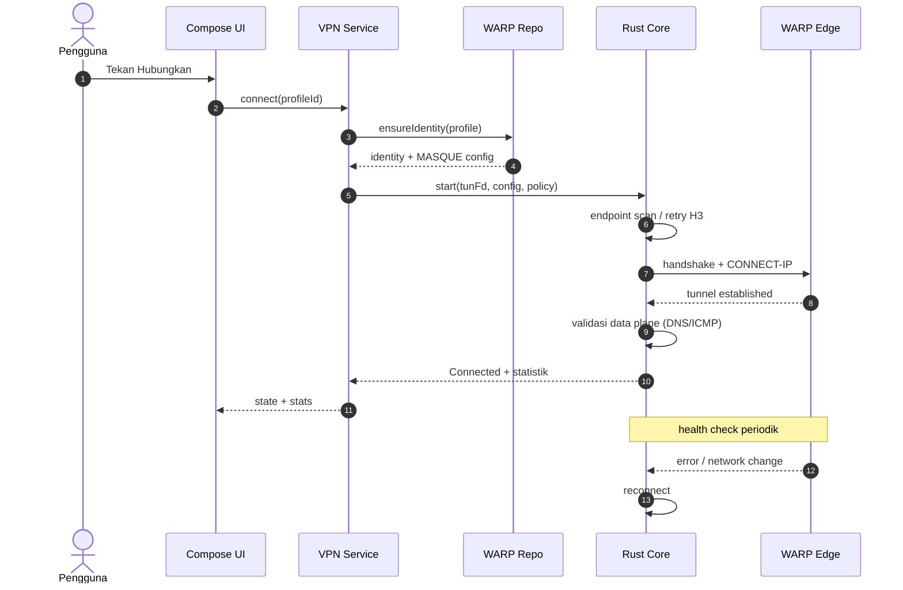
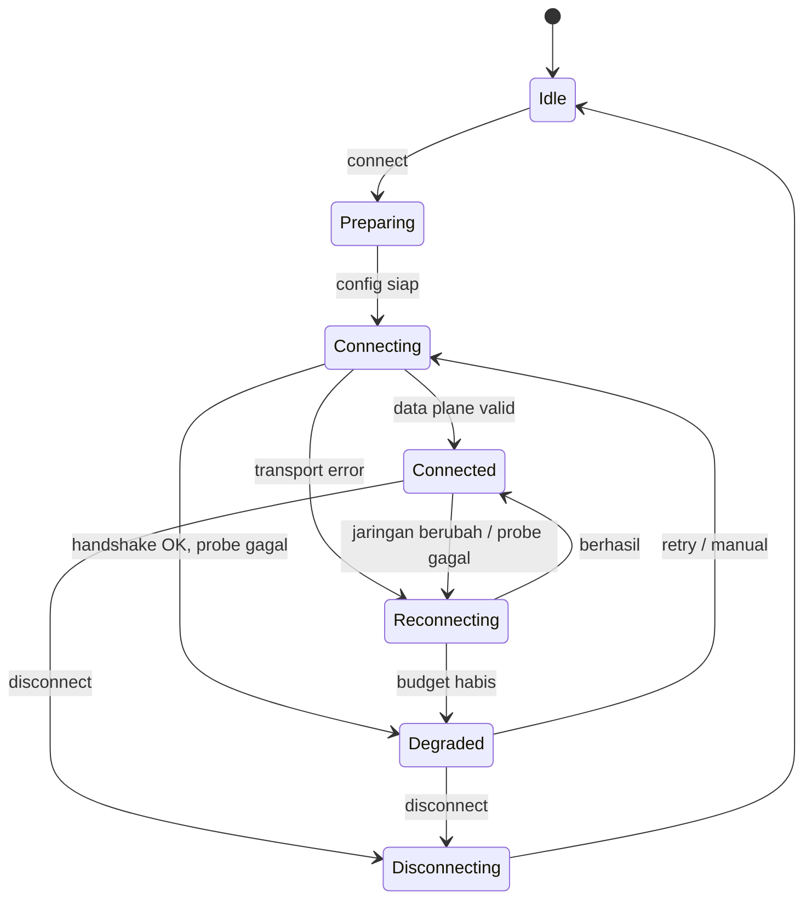

# System Design — Lintas

**Status:** Draft untuk direview  
**Tanggal:** 22 November 2026  
**Produk:** Klien MASQUE Android dengan dukungan Cloudflare WARP  
**Nama produk:** Lintas (final)  
**Platform v1:** Android 16 (target SDK 36), minSdk 29  
**Lisensi:** GPL-3.0 (open source)  
**Mockup terkait:** `mockups/lintas.html`

---

## 1. Ringkasan

Lintas adalah klien VPN Android open source yang memakai **Cloudflare WARP consumer** sebagai provider utama, dengan **MASQUE HTTP/3**. V1 fokus pada Android; self-hosted MASQUE, Zero Trust, desktop, dan iOS masuk fase berikutnya.

Arah arsitekturnya:

- **UI Kotlin + Jetpack Compose**; kontrol WARP dan profil ada di Kotlin, data plane di **Rust core**.
- **WARP adalah provider, bukan fondasi aplikasi.** Provider lain bisa ditambah tanpa mengubah UI.
- **Tidak ada backend di jalur data.** Trafik pengguna langsung ke edge Cloudflare.
- **Local-first.** Profil, identitas, dan sesi tersimpan di perangkat; connect tidak bergantung pada backend kami.
- **Control plane hanya untuk config, feature flag, dan telemetry opt-in**, disajikan dari edge dan ditandatangani.
- **Tidak ada SOCKS5 daemon lokal.** Paket TUN diproses langsung oleh netstack Rust.
- **Open source GPL-3.0.** Aether AGPL-3.0 tidak dipakai di v1; core dibangun baru dengan dependency yang kompatibel.

Dokumen ini adalah desain sistem, bukan rencana implementasi detail.

**Status build (22 November 2026):** Phase 0 shell, provisioning WARP, dan **data plane WireGuard WARP** sudah ada di repo — Compose UI empat tab, VpnService/TUN, registrasi WARP consumer, enable WARP, enrollment MASQUE (P-256 + self-signed cert), identity terenkripsi di Android Keystore, dan packet loop WireGuard Rust (`boringtun`) dengan `client_id` injection. Build Android, unit test handshake, dan **runtime test di Poco X8 Pro Max** lolos untuk **dua transport**: WireGuard dan **MASQUE H3/CONNECT-IP** (quiche). Cloudflare trace menunjukkan `warp=on`, `colo=SIN`, HTTP/3, dan ping 1.1.1.1 berhasil; kedua mode bisa berganti tanpa saling merusak identitas. H2 tidak termasuk dalam rilis ini.

---

## 2. Asumsi dan batasan

1. **Android-only untuk v1.** Desktop dan iOS ditunda; core Rust tetap portabel.
2. Fokus **WARP consumer**. Zero Trust masuk fase berikutnya.
3. Self-hosted MASQUE masuk fase berikutnya, bukan v1.
4. Kami tidak membangun jaringan edge global sendiri.
5. Tidak ada logging trafik. Diagnostik disimpan lokal; telemetry opt-in dan agregat.
6. Nama produk: **Lintas** (final). Copy dan arah visual masih bisa disempurnakan.
7. **Lisensi:** proyek open source dengan **GPL-3.0**. Aether berlisensi AGPL-3.0; jika diintegrasikan, seluruh combined work harus AGPL. V1 memilih core baru tanpa Aether.
8. API registrasi WARP consumer tidak sepenuhnya didokumentasikan dan bisa berubah; patuhi ToS Cloudflare dan rate limit.
9. **Android 16 (API 36)** menjadi target SDK/compile SDK; **minSdk 29** (Android 10).
10. Perangkat uji utama saat ini: **Poco X8 Pro Max (HyperOS, Android 16)**. Ini satu perangkat fisik; emulator dan device farm tetap diperlukan.
11. Tidak ada akun, subscription, atau billing di v1.

---

## 3. Goals, non-goals, anti-goals

### Goals

- Satu tombol connect dengan waktu connect yang cepat dan hasil yang bisa diprediksi.
- MASQUE HTTP/3 saja; tidak ada fallback HTTP/2.
- Reconnect otomatis saat jaringan berubah, tunnel putus, atau endpoint diblokir.
- Dukungan WARP consumer di Android 16.
- Split tunnel per aplikasi, kill switch, dan perlindungan kebocoran DNS/IPv6.
- Diagnostik yang bisa dibaca pengguna tanpa membocorkan rahasia.
- Data plane Rust yang portabel untuk ekspansi desktop/iOS nanti.
- Build open source yang bisa diaudit: dependency terkunci, SBOM, release bertanda tangan.
- APK yang wajar, battery-friendly, dan tidak bergantung pada backend kami.

### Non-goals

- Desktop, iOS, dan web client di v1.
- Zero Trust dan self-hosted MASQUE di v1.
- Akun, subscription, billing, atau dashboard pengguna di v1.
- Jaringan relay milik sendiri.
- Content filtering, antivirus, atau parental control.
- Anonimitas tingkat Tor.
- Dukungan router/OpenWrt di versi pertama.

### Anti-goals

- Kebocoran trafik saat tunnel mati.
- Menyimpan token, private key, atau isi trafik di log.
- Hardcode endpoint atau API WARP di UI.
- Memblokir UI selama proses connect.
- Memakai satu proses besar yang tidak bisa diuji atau di-restart.

---

## 4. Prinsip desain

1. **Android-first, core portable.** V1 Android; data plane Rust tidak bergantung pada UI.
2. **Kotlin control plane, Rust data plane.** WARP identity, profil, policy, dan UI di Kotlin; paket dan transport di Rust.
3. **Local-first.** Identitas dan profil ada di perangkat; connect tidak bergantung pada backend kami.
4. **Ports and adapters.** UI, provider, transport, dan platform adalah adapter di sekitar core.
5. **Explicit state machine.** Tidak ada state tersembunyi di UI atau service.
6. **Graceful degradation.** H3 → reconnect; fitur opsional tidak boleh memblokir connect.
7. **Signed configuration.** Config dari server harus bertanda tangan; tidak ada remote code.
8. **Privacy by default.** Tidak ada trafik yang meninggalkan perangkat ke backend kami.
9. **Observable by design.** Semua keputusan penting punya event dan kode error yang bisa didiagnosis.
10. **Open source by default.** Lisensi, dependency, dan build harus bisa diaudit publik.

---

## 5. Arsitektur tingkat tinggi

V1 hanya Android. Kontrol dan identitas WARP ada di Kotlin; data plane ada di Rust core. Dua diagram berikut memisahkan keduanya.





### Prinsip pemisahan process

- **Android:** UI Compose berjalan di process utama; VpnService, WARP repository, Room, dan Rust core berjalan di process `:vpn`. Kalau UI dibunuh, tunnel tetap hidup. UI berkomunikasi lewat Binder/AIDL dengan signature permission.
- **Kotlin control plane:** registrasi WARP, penyimpanan profil, kebijakan routing, dan notifikasi ada di Kotlin. Ini mempercepat v1 dan memanfaatkan API Android langsung.
- **Rust data plane:** TUN, netstack, transport MASQUE, endpoint probe, dan statistik ada di Rust. Core tidak tahu WARP API atau Android UI.
- **Future:** desktop/iOS memakai core Rust yang sama dengan control plane platform masing-masing. Tidak ada Flutter di v1.

---

## 6. Komponen

### 6.1 UI: Kotlin + Jetpack Compose

- Kotlin 2.x, Jetpack Compose, Material 3, Navigation Compose.
- State: ViewModel + StateFlow/SharedFlow; tidak ada state tunnel di UI.
- DI: Hilt; async: Coroutines/Flow.
- Mengikuti arah visual mockup: route-first, status jelas, pengaturan ringkas.
- Tidak pernah memegang private key atau token WARP.
- Perintah: `connect`, `disconnect`, `selectRoute`, `scan`, `exportDiagnostics`.
- Menerima event: state berubah, statistik, progress scan, error yang sudah dipetakan.
- Tetap responsif saat connect; semua operasi jaringan di service/core.

### 6.2 Tunnel Controller (Kotlin)

Lapisan tipis antara UI dan service `:vpn`:

- `VpnControlViewModel` + `TunnelRepository`.
- Memetakan command UI ke AIDL service.
- Menyimpan state tampilan (screen, pilihan route) — bukan state tunnel.
- Menggabungkan event service dan data profil.
- Tidak membuka port TCP lokal; memakai Binder dengan signature permission.

#### Kontrak UI ↔ Service

| Command | Input | Output / event |
|---|---|---|
| `connect` | `profileId`, opsi override | `stateChanged`, `progress`, `error` |
| `disconnect` | — | `stateChanged(Idle)` |
| `getState` | — | snapshot state + sesi aktif |
| `listProfiles` | — | daftar profil (tanpa secret) |
| `upsertProfile` | data profil | profil tersimpan |
| `deleteProfile` | `profileId` | sukses / error |
| `scanGateways` | mode scan | `scanProgress`, daftar endpoint |
| `setRoutePolicy` | `routePolicyId` | `stateChanged` bila perlu reconnect |
| `getStats` | — | bytes, RTT, durasi, reconnect count |
| `exportDiagnostics` | rentang waktu | file/path yang sudah diredaksi |
| `revokeIdentity` | `identityId` | identitas dihapus dari perangkat |

Semua command punya timeout, idempotency key, dan error code stabil. Event dikirim sebagai stream; UI tidak melakukan polling.

### 6.3 Android VpnService (process `:vpn`)

- Kotlin, `VpnService.Builder`; address, route, DNS, MTU.
- Foreground service dengan tipe yang sesuai Android 16; notifikasi status.
- `POST_NOTIFICATIONS`; jelaskan consent VPN dan always-on.
- `NetworkCallback`; `setUnderlyingNetworks`.
- Always-on VPN, `setBlocking`/kill switch.
- Split tunnel per aplikasi lewat allowed/disallowed application.
- Room untuk profil, sesi, dan scan cache; secret di Android Keystore.
- Menjalankan `WarpRepository` dan menyerahkan TUN fd + config + policy ke Rust core lewat JNI.
- Tidak melakukan parsing paket; itu tugas core.
- HyperOS/Poco: uji autostart, battery optimization, dan FGS killer.

### 6.4 Rust core

Core v1 adalah **data-plane library**; kontrol WARP dan profil ada di Kotlin.

| Module | Tanggung jawab |
|---|---|
| `transport` | MASQUE H3, WireGuard opsional, endpoint probe |
| `netstack` | TUN I/O, TCP/UDP/ICMP, flow table, DNS interception, MTU |
| `policy` | Menerapkan split tunnel, DNS policy, dan route rules dari Kotlin |
| `session` | State machine tunnel, health check, reconnect, stats |
| `diag` | Ring buffer log, redaction, export |
| `ffi` | JNI API stabil untuk `:vpn` |

Prinsip core:

- Tidak tahu apa-apa tentang Android UI atau WARP API.
- Menerima `tunFd`, config transport, dan policy dari Kotlin.
- Semua API async dan bisa dibatalkan.
- Error punya kode stabil, bukan string bebas.
- Buffer paket dibatasi; tidak ada queue tanpa batas.
- Endpoint probe dan handshake dilakukan di core; daftar kandidat datang dari WARP repository.

JNI surface dijaga kecil: `start(tunFd, configJson, policyJson)`, `stop()`, `status()`, `updatePolicy(policyJson)`, `stats()`. Event dikirim lewat callback ke service.

### 6.5 WARP provider (Kotlin, v1)

- Modul Kotlin di `:vpn`, bukan di Rust core.
- Generate keypair; simpan private key di Android Keystore.
- Registrasi WARP consumer; simpan `device_id`, token, dan config yang diterima.
- Satu identitas WARP dipakai untuk WireGuard dan MASQUE; `tunnel_type` di PATCH saat protokol berganti.
- Enroll MASQUE pada device yang sama (termasuk certificate) dan rotasi certificate sebelum expiry.
- Ambil daftar endpoint, SNI, dan parameter transport; serahkan ke core.
- Dukung WARP+ license: dialog di Setelan, `PUT /reg/{device_id}/account` dengan body `{"license": ...}`; status dibaca dari `warp_plus`/`account_type` dan disimpan terenkripsi.
- Zero Trust ditunda ke fase berikutnya.
- Tangani 401/403/429 dengan backoff; jangan registrasi ulang setiap launch.
- Revoke identity saat reset/logout.

Interface yang disarankan:

```kotlin
interface WarpRepository {
    suspend fun ensureIdentity(profile: Profile): WarpSession
    suspend fun refreshIfNeeded(identity: WarpIdentity): WarpIdentity
    suspend fun prepareTransport(identity: WarpIdentity): TransportConfig
    suspend fun revoke(identity: WarpIdentity)
}
```

UI tidak pernah tahu detail registrasi WARP; service yang memanggil repository dan menyerahkan `TransportConfig` ke core. Jika nanti Zero Trust atau self-hosted ditambahkan, kontrak ini tetap bisa dipakai dengan implementasi provider lain.

Status implementasi: registrasi WARP consumer, enable WARP, dan enrollment MASQUE sudah ada di `WarpApiClient`; identity disimpan terenkripsi lewat `WarpIdentityStore`. **Satu identity dipakai WireGuard dan MASQUE**; saat protokol berganti, app melakukan PATCH `tunnel_type` pada device yang sama, sehingga akun/WARP+ tetap konsisten. MASQUE H3 memakai `masque.rs` (quiche): client cert P-256, `cf-connect-ip`, CONNECT-IP, dan endpoint key pinning. Pilihan protokol disimpan di Setelan dan dipakai tombol Beranda. **Aktivasi WARP+** memakai device dan token yang sama; error license tidak merusak koneksi gratis. Alur error invalid key sudah diuji (HTTP 400), aktivasi sukses memerlukan license key pengguna.

### 6.6 Transport layer

- **MASQUE H3:** quiche (HTTP/3, CONNECT-IP), transport utama.
- **WireGuard:** boringtun, **transport pertama yang diimplementasikan** untuk WARP; `client_id` di-inject ke bytes 1..4 setelah boringtun membentuk handshake (dan di-strip dari paket masuk) agar MAC tetap valid. Handshake, round-trip paket, dan koneksi WARP nyata sudah lolos uji.
- **MASQUE H3:** diimplementasikan dengan quiche; client cert P-256, `cf-connect-ip`, HTTP/3 datagrams, endpoint key pinning, dan CONNECT-IP. H2 sengaja tidak diimplementasikan pada rilis ini.
- **Endpoint scanner:** kandidat endpoint dari config WARP + seed bawaan; probe paralel dengan concurrency terbatas; validasi data plane, bukan hanya handshake.
- **Retry H3:** coba endpoint berikutnya bila handshake gagal; jangan membanjiri jaringan.
- **Health:** probe periodik murah (DNS/ICMP di dalam tunnel), backoff saat gagal, berhenti saat doze.
- **Self-hosted MASQUE:** fase berikutnya; bukan target v1.

### 6.7 Netstack

Alur paket:

```text
App → TUN → netstack → flow table → CONNECT-IP → MASQUE → WARP edge
App ← TUN ← netstack ← flow table ← CONNECT-IP ← MASQUE ← WARP edge
```

Detail:

- Baca/tulis TUN di thread khusus; gunakan buffer pool.
- TCP state machine: `smoltcp` atau `netstack-smoltcp`.
- UDP flow table dengan timeout dan batas jumlah flow.
- ICMP echo untuk validasi dan diagnosa.
- DNS interception: UDP/TCP 53 dialihkan ke resolver internal.
- MTU dan MSS clamping; path MTU discovery.
- Backpressure: bila queue penuh, drop paling lama, jangan tumbuhkan memori tanpa batas.
- Statistik per flow dan agregat untuk UI.

### 6.8 Policy engine

Mode routing v1:

- **Full tunnel:** semua trafik masuk tunnel.
- **Include-only:** hanya aplikasi tertentu.
- **Exclude:** semua kecuali daftar aplikasi.

Aturan:

- Android per-app policy dibangun di Kotlin; core menerapkan policy pada flow.
- Urutan first-match; match berdasarkan app ID, CIDR, port, dan protokol.
- Domain rules memakai DNS sniffing/SNI; IP rules diterapkan setelah resolusi.
- Perubahan policy memicu update route atau reconnect bila perlu.
- Kill switch: bila tunnel tidak sehat, trafik yang seharusnya masuk tunnel harus drop, bukan keluar langsung.
- SOCKS-only/desktop routing ditunda ke fase desktop.

### 6.9 Local store dan secure storage

- Room di process `:vpn` untuk profil, session history, scan cache, dan diagnostic events.
- Field sensitif dienkripsi dengan kunci di Android Keystore (StrongBox bila tersedia).
- Private key dan token tidak pernah masuk Room dalam bentuk plaintext.
- Core menerima config yang sudah didekripsi lewat JNI; core tidak menyimpan database.
- UI mengakses profil lewat AIDL; tidak membuka database langsung.
- Backup: kecualikan database dan secret dari cloud backup kecuali user memilih export terenkripsi.

### 6.10 Signed remote config

Contoh payload:

```json
{
  "version": 42,
  "issued_at": "2026-11-22T00:00:00Z",
  "expires_at": "2026-12-22T00:00:00Z",
  "min_app_version": "1.0.4",
  "endpoints": {
    "warp_masque_seeds": ["..."],
    "scan_timeout_ms": 2500
  },
  "features": {
    "telemetry": false
  }
}
```

- Ditandatangani Ed25519; public key di-pin di aplikasi.
- Default config dibundel di app; remote config hanya menimpa.
- Config invalid atau expired → pakai default; jangan blokir connect.
- Tidak ada remote code, script, atau URL arbitrer yang dieksekusi.

### 6.11 Optional control plane

Backend **tidak berada di jalur data**. Fungsinya hanya:

- Distribusi config dan feature flag (Cloudflare Workers + R2).
- Telemetry opt-in dan agregat (Workers + queue + storage).
- Berbagi profil self-hosted lewat kode pendek (fase berikutnya).

Tidak ada akun, subscription, billing, atau dashboard pengguna di v1. Rekomendasi: mulai sebagai **edge-native modular service**, bukan Kubernetes. Cloudflare Workers + R2/KV/D1 cukup untuk skala awal dan dekat dengan edge. Data plane tetap langsung ke Cloudflare.

**Skalabilitas dan availability:**

- Control plane bersifat stateless di edge; config di-cache di CDN/R2.
- Tidak ada state per pengguna di jalur data; WARP menangani skala koneksi.
- Telemetry memakai queue dan sampling; bukan write per request ke database utama.
- Kalau control plane down, aplikasi tetap connect memakai config default dan identitas lokal.
- Kalau WARP API down tetapi identitas masih valid, connect tetap dicoba dengan config tersimpan.
- Config dan endpoint punya versi; rollback cukup mengubah pointer versi.

---

## 7. Lifecycle koneksi



### State machine



Aturan state:

- `Connecting` punya timeout total, bukan timeout per langkah yang tak terbatas.
- `Reconnecting` memakai exponential backoff + jitter.
- Endpoint terakhir yang sehat dicoba lebih dulu.
- Setelah N kegagalan, lakukan scan ulang.
- Perubahan jaringan mereset backoff dan memicu path baru.
- User selalu bisa cancel; cancel harus benar-benar menghentikan socket dan thread.

---

## 8. Keputusan desain utama

| Keputusan | Pilihan | Alasan | Trade-off |
|---|---|---|---|
| Core data plane | Rust library in-process via JNI | Tanpa SOCKS5 perantara; latensi dan battery lebih baik; satu state machine | Perlu netstack dan FFI; lebih banyak kerja awal |
| UI | Kotlin + Jetpack Compose | Android-only; akses langsung VpnService, Keystore, FGS; APK lebih kecil; lifecycle service lebih sederhana | Tidak reusable untuk desktop/iOS |
| Control plane | Kotlin `:vpn` service + Room | WARP identity, profil, policy, dan notifikasi dekat dengan API Android | Logika tidak langsung portable; core harus tetap bersih |
| WARP provider | Kotlin `WarpRepository`; consumer only | Registrasi dan identity memakai API Android/Keystore langsung | Zero Trust dan provider lain harus ditambah nanti |
| Transport v1.0.4 | WireGuard WARP + MASQUE H3 | Satu identitas WARP, dua transport; WireGuard via boringtun, MASQUE via quiche/CONNECT-IP; keduanya diverifikasi di Poco | PATCH `tunnel_type` saat berganti protokol |
| Identitas WARP | Registrasi langsung dari perangkat | Tidak perlu backend di jalur data; privasi lebih baik | Bergantung pada API/ToS Cloudflare; rate limit |
| WARP+ | License key via dialog Setelan | Akun/device sama; WARP+ tetap konsisten dengan WireGuard/MASQUE | Butuh key valid; aktivasi lewat API Cloudflare |
| Config | Signed JSON dari edge | Endpoint dan flag bisa berubah tanpa rilis app | Perlu key management dan rollback |
| Profile store | Room di `:vpn` + Android Keystore | Service bisa connect tanpa UI; secret aman | Skema DB perlu migrasi dan enkripsi field |
| IPC | Binder/AIDL dengan signature permission | Tidak ada port TCP lokal; cocok untuk Android-only | Perlu desain permission dan lifecycle |
| Telemetry | Opt-in, event-based, agregat | Privasi; tetap bisa mengukur kualitas | Sample lebih kecil; butuh disiplin skema |
| Lisensi | GPL-3.0 | Open source, copyleft, komunitas bisa memverifikasi | Tidak bisa men-link Aether AGPL tanpa pindah ke AGPL |
| Scope v1 | Android 16, WARP consumer | Fokus dan waktu rilis | Desktop/iOS/Zero Trust/self-hosted ditunda |

### Kenapa tidak memakai arsitektur Oblivion apa adanya?

Oblivion memakai Aether sebagai subprocess, SOCKS5 lokal, dan `hev-socks5-tunnel` untuk menjembatani TUN. Pendekatan itu terbukti, tetapi:

- Ada dua proses dan satu konversi SOCKS5 yang menambah overhead.
- Kill switch dan state tunnel tersebar antara VpnService, Aether, dan UI.
- Aether AGPL-3.0: jika di-link, seluruh combined work harus AGPL; proyek ini memilih GPL-3.0.
- Sulit mengukur dan mengoptimalkan data plane secara end-to-end.

Untuk produk baru, core Rust in-process lebih bersih. Jika kecepatan rilis lebih penting, Aether bisa dipakai sebagai **spike berlisensi AGPL**, bukan fondasi jangka panjang.

---

## 9. Model data

| Entity | Field utama | Catatan |
|---|---|---|
| `Profile` | `id`, `kind`, `display_name`, `endpoint`, `route_policy_id`, `transport_prefs`, `created_at`, `last_used_at` | `kind`: `warp_consumer` di v1; `warp_zero_trust`, `masque_custom`, `wireguard` menyusul |
| `WarpIdentity` | `id`, `device_id`, `account_type`, `warp_plus`, `license_key`, `token_ref`, `wg_key_ref`, `masque_cert_ref`, `active_tunnel_type`, `expires_at` | Semua `*_ref` menunjuk ke Android Keystore |
| `RoutePolicy` | `id`, `mode`, `apps`, `domains`, `cidrs`, `ports`, `default_action` | Disimpan di Room; perubahan memicu update policy ke core |
| `ScanCache` | `network_hash`, `transport`, `endpoint`, `rtt_ms`, `success`, `last_seen` | `network_hash` bukan SSID plaintext; cache per jaringan |
| `Session` | `id`, `profile_id`, `transport`, `endpoint`, `started_at`, `ended_at`, `bytes_in`, `bytes_out`, `reconnects`, `error_code` | Tidak menyimpan isi trafik |
| `DiagnosticEvent` | `id`, `session_id`, `ts`, `level`, `code`, `message_redacted` | Ring buffer; export manual |
| `RemoteConfig` | `version`, `payload`, `signature`, `fetched_at`, `expires_at` | Diverifikasi sebelum dipakai |

Catatan penyimpanan:

- Room berada di process `:vpn`; UI mengakses lewat AIDL, bukan langsung.
- Field sensitif dienkripsi dengan kunci Keystore; token/private key tidak pernah disimpan plaintext.
- Skema Room punya version dan migration test; data yang tidak bisa dimigrasikan harus bisa dibuang tanpa mematikan tunnel.
- Core Rust tidak memiliki database di v1; ia menerima config dan policy yang sudah disiapkan Kotlin.

---

## 10. Keamanan dan privasi

### Threat model

| Ancaman | Dampak | Mitigasi |
|---|---|---|
| DPI / pemblokiran endpoint | Tidak bisa connect | Endpoint scan, SNI/TLS fragmentation bila didukung, rotasi endpoint |
| Aplikasi lokal jahat | Menyalahgunakan tunnel/profil | AIDL dengan signature permission; secret tidak diekspos ke UI |
| Perangkat dicuri | Identitas WARP disalahgunakan | Android Keystore; enkripsi database; revoke identity saat reset |
| Config server disusupi | Endpoint palsu / fitur berbahaya | Signed config, pinning public key, expiry, rollback ke default |
| Supply chain | Dependency berbahaya | Lockfile, `cargo-deny`, Gradle dependency verification, SBOM, review dependency, signed release |
| DNS/IPv6 leak | Privasi bocor | DNS interception, block outside DNS, IPv6 route policy, kill switch |
| Log bocor | Token/alamat sensitif | Redaction, level log, local-only, opt-in export |
| Rate limit WARP | Registrasi gagal | Simpan identity, backoff, jangan re-register, pesan yang jelas |
| FGS dibunuh OEM | Tunnel mati | Foreground service, always-on VPN, panduan battery optimization; uji HyperOS |

### Prinsip keamanan

- Tidak ada port TCP lokal untuk kontrol; hanya Binder/AIDL.
- Secret hanya di Android Keystore; zeroize salinan di memori setelah dipakai.
- Tidak ada `toString()`/log untuk objek yang memuat token.
- Kill switch default ON untuk full tunnel.
- DNS default melalui tunnel; plaintext DNS di luar tunnel diblokir.
- Update dan config harus bertanda tangan.
- Build release tidak `debuggable`; simbol dipisah.
- Root detection bukan security boundary; jangan mengandalkannya.
- Minta izin notifikasi dan jelaskan consent VPN; jangan menyembunyikan selalu-on VPN.

### Android 16 dan HyperOS

- Target SDK 36; deklarasikan foreground service type yang sesuai dan permission `POST_NOTIFICATIONS`.
- Uji always-on VPN, `setBlocking`, dan restart service setelah process death.
- HyperOS/Poco: uji autostart, battery saver, "killer" FGS, dan perilaku setelah reboot.
- Jangan meminta `REQUEST_IGNORE_BATTERY_OPTIMIZATIONS` secara agresif; tampilkan panduan yang bisa ditolak user.

### Lisensi dan kepatuhan

- **Proyek: GPL-3.0.** Source tersedia; derivative harus tetap open source.
- **Aether: AGPL-3.0.** Jika diintegrasikan, seluruh combined work harus AGPL. V1 memilih core baru tanpa Aether.
- **Oblivion: MIT.** Pola UI dan arsitektur boleh dipakai dengan atribusi.
- **quiche: BSD-2-Clause**, **boringtun: BSD-3-Clause**, **smoltcp: MIT/Apache-2.0** — kompatibel dengan GPL-3.0; verifikasi ulang dengan `cargo-deny` dan license plugin Gradle.
- WARP adalah layanan Cloudflare. Gunakan sesuai ToS; jangan menyalahgunakan API registrasi consumer untuk skala besar.
- Distribusi v1: **GitHub Releases** (APK bertanda tangan + source). Play Store dan F-Droid ditunda; F-Droid dapat menandai WARP sebagai layanan non-free network.
- Tidak ada billing/akun di v1, jadi tidak ada data pembayaran yang disimpan.

---

## 11. Reliability dan performa

### Endpoint selection

- Kandidat dari config WARP + seed bawaan.
- Probe paralel dengan batas concurrency (mis. 6–8).
- Skor endpoint: success rate, RTT, jitter, packet loss, waktu terakhir gagal.
- Cache per jaringan; invalidasi saat jaringan berubah atau setelah TTL.
- Data-plane validation: kirim probe DNS/ICMP melalui tunnel; jangan hanya percaya handshake.

### Reconnect

- Last-known-good endpoint dicoba lebih dulu.
- Backoff: 250 ms, 500 ms, 1 s, 2 s, 4 s, 8 s (cap), dengan jitter.
- Setelah 3–5 kegagalan, scan ulang.
- Perubahan jaringan → reset backoff, coba H3 lagi.
- Jangan reconnect saat perangkat doze kecuali always-on.

### Battery dan performa

- Hindari polling agresif; health check adaptif (mis. 15–30 s saat aktif, berhenti saat idle/doze).
- Buffer pool dan batch I/O; hindari alokasi per paket.
- Batasi flow table dan queue.
- Ukur overhead CPU dan battery di Phase 0 sebelum komit ke arsitektur.
- Android: foreground service, `setUnderlyingNetworks`, `NetworkCallback`; jangan membangunkan CPU tanpa kebutuhan.
- **Poco X8 Pro Max / HyperOS:** uji autostart, battery saver, reboot, dan FGS killer. Catat konsumsi battery idle minimal 1 jam.
- **Android 16:** uji FGS type, notifikasi, dan always-on; jangan mengandalkan perilaku Android lama.

### Failure modes

| Kegagalan | Perilaku yang diinginkan |
|---|---|
| WARP API tidak bisa dihubungi | Pakai identitas + config lokal; kalau belum ada identitas, tampilkan error dengan retry |
| Registrasi kena rate limit (429) | Backoff + jitter; jangan registrasi ulang; pesan yang jelas |
| Endpoint H3 diblokir | Scan endpoint lain dan coba ulang H3 |
| Data plane gagal setelah handshake | Tandai endpoint tidak sehat; coba endpoint lain; jangan tampilkan “connected” |
| Jaringan berubah | Coba QUIC migration; bila gagal, reconnect dengan last-known-good |
| Control plane down | Pakai config default; fitur yang butuh config baru ditunda |
| Room/database rusak | Bangun ulang cache; identitas yang tidak bisa dipulihkan perlu registrasi ulang |
| Service Android dibunuh | Always-on VPN memicu start ulang; state dipulihkan dari Room |
| Config signature invalid | Tolak config; pakai default; catat event lokal |

### Target SLO awal

| Metrik | Target |
|---|---|
| Connect success (jaringan baik) | ≥ 99% |
| Time to connect p50 | ≤ 1.5 s |
| Time to connect p95 | ≤ 5 s |
| Reconnect p95 | ≤ 3 s |
| Crash-free sessions | ≥ 99.5% |
| Battery idle | ≤ 2%/jam |
| Packet overhead | < 1% |

Angka ini hipotesis; validasi di spike dan di Poco X8 Pro Max.

---

## 12. Observability

### Lokal

- Ring buffer 2–5 MB; level `error`, `warn`, `info`, `debug`.
- Setiap event punya `code` stabil, mis. `WARP_REG_429`, `MASQUE_H3_TIMEOUT`, `DNS_LEAK_BLOCKED`.
- Redaction otomatis untuk token, private key, authorization header, dan IP publik.
- Export manual ke file teks/JSON; user melihat preview sebelum share.

### Opt-in telemetry

- Event agregat: connect funnel, transport mix, error codes, endpoint health, versi app.
- Tanpa domain, IP, isi trafik, atau user identifier permanen.
- Default OFF; user harus setuju secara eksplisit.
- Sampling dan rate limit di edge.
- Retensi terbatas (mis. 30 hari).
- Bisa dimatikan total kapan saja.

### Backend dashboard

- Connect success per versi/transport/negara (kasar).
- Error code terbanyak.
- Config fetch failure.
- Endpoint health.
- Alert bila connect success turun atau error registrasi melonjak.

---

## 13. Deployment dan operasi

### Struktur repo yang disarankan

```text
app/                 # Compose UI, ViewModel, navigation
vpn/                 # VpnService, AIDL, Room, WarpRepository, foreground service
core/                # Rust workspace: transport, netstack, policy, session, ffi
infra/
  config/            # Workers, R2, signing keys
docs/
```

V1 tidak memiliki modul desktop atau iOS. Core Rust tetap dipisahkan agar bisa dipakai platform lain nanti.

### Build dan rilis

- Build Android: Gradle + Kotlin + Compose; Rust dibangun lewat `cargo-ndk` dan di-link ke `:vpn` via JNI.
- CI: `./gradlew lint test`, instrumented tests, `cargo fmt`, `clippy`, `test`, `cargo-deny`, `cargo-audit`.
- SBOM per rilis; dependency verification Gradle; release ditandatangani; build reproducible bila memungkinkan.
- Channel: internal → beta → stable; staged rollout 5% → 25% → 100%.
- Distribusi v1: GitHub Releases. APK bertanda tangan, checksum, release notes, dan source GPL-3.0. Play Store/F-Droid menyusul.
- Source GPL-3.0 tersedia untuk setiap rilis; tag dan changelog publik.
- Remote min-version untuk mematikan versi bermasalah tanpa mematikan tunnel yang sedang berjalan.

### Build lokal (Phase 0)

```bash
export ANDROID_NDK_HOME=/opt/android-sdk/ndk/27.0.12077973

cd core
cargo ndk -t arm64-v8a -t x86_64 -P 29 -o ../app/src/main/jniLibs build --release
cd ..

./gradlew :app:assembleDebug
```

- APK debug: `app/build/outputs/apk/debug/app-debug.apk` (v1.0.4).
- Unit test core: `cd core && cargo test --release`; handshake WireGuard sudah lulus.
- MASQUE memakai quiche + BoringSSL; build Android memerlukan NDK/CMake dan waktu kompilasi lebih lama.
- Runtime verification: install di Poco X8 Pro Max; WireGuard dan MASQUE masing-masing menghasilkan `warp=on`, `colo=SIN`, dan HTTP/3 di `https://www.cloudflare.com/cdn-cgi/trace`.
- Network handover: Wi-Fi ↔ seluler hanya me-restart transport/socket; TUN/VPN interface tetap terbuka sehingga koneksi TCP yang sudah ada tidak ikut diputus.
- JDK 21, Android SDK 36, Gradle wrapper 8.11.1, Rust stable, dan `cargo-ndk` diperlukan.
- Debug APK memakai debug signing; release GitHub butuh keystore terpisah.
- Debug APK lebih besar karena berisi dua ABI dan icon set; release/minified akan lebih kecil.

### Open-source governance

- `LICENSE` GPL-3.0, `CONTRIBUTING.md`, `SECURITY.md`, issue/PR template.
- DCO atau CLA ringan; keputusan arsitektur dicatat sebagai ADR.
- Jangan merge dependency dengan lisensi yang tidak kompatibel; cek otomatis di CI.
- Reproducible build dipertahankan agar komunitas bisa memverifikasi APK; siapkan CI rilis GitHub.

### Config rollout

- Config baru diuji di staging.
- Canary 5% selama 24 jam; monitor error dan connect success.
- Rollback ke config sebelumnya jika ada regresi.
- Default config selalu tersedia di app.

---

## 14. Testing strategy

### Unit dan property tests

- State machine: semua transisi, cancel, timeout, race.
- Route policy: first-match, app/CIDR/port, default action.
- Config parsing dan signature verification.
- Redaction log.
- Serialization profile/identity.
- Room migration tests.

### Fuzzing

- Parser response WARP API.
- Parser config.
- Parser DNS/SNI.
- Packet parsing di netstack.
- `cargo-fuzz` untuk target kritis.

### Integration

- Local MASQUE test server (quiche) untuk H3.
- Network emulation: latency, loss, jitter, MTU kecil, bandwidth terbatas.
- Simulasi DPI: blokir UDP, reset TLS, blokir SNI tertentu.
- IPv6-only, dual-stack, captive portal, DNS rusak.
- Sleep/wake, network switch Wi-Fi ↔ seluler, airplane mode.
- JNI boundary: start/stop berulang, cancel saat handshake, service restart.

### Device dan chaos

- **Perangkat utama: Poco X8 Pro Max (HyperOS, Android 16).**
- Emulator API 36 untuk baseline Android 16; tambah API 34/35 dan API 29 (minSdk) untuk regression.
- HyperOS: autostart, battery saver, FGS killer, reboot, always-on VPN.
- Chaos: matikan jaringan di tengah flow, blokir endpoint, token expired, clock skew, config expired.
- E2E canary ke WARP memakai akun uji; tidak dijalankan di setiap commit.
- Karena fisik baru satu, pertimbangkan Firebase Test Lab/device farm sebelum beta publik.

### Security

- SAST/DAST, secret scanning, dependency audit.
- Review AIDL permission dan exported components.
- Uji kill switch dan DNS leak dengan alat eksternal.
- Uji notifikasi/FGS dan consent VPN di Android 16.

---

## 15. Roadmap

| Phase | Scope | Exit criteria |
|---|---|---|
| **0. Spike** | Compose shell + Rust core + registrasi WARP + MASQUE H3 + CONNECT-IP di Poco/Android 16 | Bisa connect, kirim/receive paket, ukur throughput/battery; MASQUE H3 terbukti |
| **1. Android MVP** | WARP consumer, full tunnel, kill switch, split tunnel per app, DNS, profil, diagnostik, UI Compose | Connect success ≥ 95% di jaringan uji; crash-free ≥ 99%; kill switch lolos; GitHub Release pertama |
| **2. Reliability** | Endpoint scan/cache, reconnect, network change, signed config, telemetry opt-in, hardening Android 16/HyperOS | p95 connect ≤ 5 s; reconnect p95 ≤ 3 s; error code lengkap |
| **3. Ekspansi provider** | Self-hosted MASQUE, Zero Trust, WARP+ | Provider abstraction terbukti; tidak mengubah UI |
| **4. Platform lain** | Desktop/iOS memakai core Rust yang sama | Core stabil dan portabel; UI platform terpisah |

**Status 22 November 2026:** Phase 0 shell, WARP provisioning, dan data plane **WireGuard WARP + MASQUE H3/CONNECT-IP** selesai dan **terverifikasi runtime di Poco X8 Pro Max** (Cloudflare trace: `warp=on`, `colo=SIN`, HTTP/3; ping 1.1.1.1 sukses). HTTP/2 tidak termasuk.

V1 berhenti di Phase 2. Phase 3 dan 4 tidak boleh menahan rilis Android.

---

## 16. Risiko

| Risiko | Dampak | Mitigasi |
|---|---|---|
| API WARP berubah / tidak resmi | Connect gagal setelah update | Provider adapter, contract test, remote config, fallback |
| Rate limit registrasi | User baru tidak bisa daftar | Simpan identity, backoff, pesan jelas |
| GPL vs Aether AGPL | Tidak bisa memakai Aether tanpa pindah lisensi | Core baru tanpa Aether; keputusan lisensi dicatat |
| Kompleksitas netstack | Jadwal molor, bug paket | Spike lebih dulu; mulai dari full tunnel sederhana; ukur |
| Satu perangkat uji (Poco/HyperOS) | Bug OEM lain tidak terdeteksi | Emulator API 29/34/36 + device farm sebelum beta |
| Android 16 FGS/notification | Service tidak jalan atau notifikasi tidak muncul | Uji FGS type, `POST_NOTIFICATIONS`, always-on |
| OEM membunuh service | Tunnel mati | Foreground service, always-on VPN, panduan battery |
| DPI arms race | Endpoint diblokir | Scan, rotasi, fragmentasi; jangan janji “tidak pernah diblokir” |
| Distribusi GitHub-only | Update manual, discoverability, dan kepercayaan user | APK bertanda tangan, checksum, release notes, panduan update, dan sumber GPL-3.0 |
| Keberlanjutan open source | Kontributor/maintainer terbatas | Governance jelas, dokumentasi, CI otomatis |
| ToS/rate limit WARP | Layanan dibatasi | Patuhi ToS; jangan scale abuse; siapkan fallback provider |

---

## 17. Keputusan yang sudah diambil

| # | Keputusan |
|---|---|
| 1 | **Android-only** untuk v1. |
| 2 | **Open source, GPL-3.0.** |
| 3 | Fokus **WARP consumer**; Zero Trust fase berikutnya. |
| 4 | **Tidak ada akun, subscription, atau billing** di v1. |
| 5 | **Self-hosted MASQUE** fase berikutnya. |
| 6 | **Telemetry opt-in**, default OFF. |
| 7 | UI **Kotlin + Jetpack Compose**. |
| 8 | Target **Android 16 (API 36)**, minSdk 29; uji utama **Poco X8 Pro Max (HyperOS)**. |
| 9 | Distribusi v1: **GitHub Releases**; Play/F-Droid menyusul. |
| 10 | Nama produk: **Lintas** (final). |
| 11 | Data plane: **WireGuard WARP** dan **MASQUE H3/CONNECT-IP** dengan **satu identitas WARP**; pilihan protokol di Setelan. WARP+ diaktifkan dengan license key pada identity yang sama. H2 tidak dipakai. |

### Kenapa Kotlin + Compose?

Karena v1 Android-only, Compose menghilangkan lapisan Flutter dan platform channel yang tidak memberi manfaat sekarang. Kotlin memberi akses langsung ke `VpnService`, Binder/AIDL, Keystore, `ConnectivityManager`, foreground service, dan notifikasi Android 16. APK lebih kecil, lifecycle service lebih sederhana, dan UI bisa mengikuti mockup dengan Material 3. Risikonya, UI tidak reusable untuk desktop/iOS; tetapi core Rust tetap portabel, jadi keputusan ini bisa ditinjau ulang saat ekspansi platform.

### Masih terbuka

- Siapa pemegang signing key dan akun GitHub rilis?
- Butuh device farm (Firebase Test Lab) untuk OEM selain Poco?
- GPL-3.0 final, atau pindah ke AGPL-3.0 agar Aether bisa dipakai?
- Kebijakan privasi dan isi halaman rilis GitHub.
- Target ukuran APK dan baseline performa di Poco.

---

## 18. Ringkasan keputusan yang direkomendasikan

- **Android-only v1**, target Android 16 (API 36), minSdk 29; uji utama Poco X8 Pro Max.
- **Kotlin + Jetpack Compose** untuk UI, ViewModel, Room, dan WARP repository.
- **Rust core in-process** untuk TUN, netstack, MASQUE, dan transport; bukan subprocess Aether + SOCKS5.
- **WARP consumer** sebagai provider v1; **WireGuard WARP** dan **MASQUE H3** memakai satu identitas; pilihan protokol tersedia; polishing berikutnya.
- **GPL-3.0 open source**; core baru tanpa Aether AGPL.
- **Tanpa akun/billing**; backend hanya signed config dan telemetry opt-in.
- **Self-hosted/Zero Trust** fase berikutnya, tanpa mengubah UI.
- **Distribusi GitHub Releases dulu**; APK bertanda tangan + source GPL-3.0. Play/F-Droid menyusul.
- **Phase 0 shell + WARP provisioning** sudah berjalan (Compose, TUN, JNI packet loop, registrasi WARP, enrollment MASQUE, pemilihan protokol); WireGuard dan MASQUE sudah terverifikasi.
